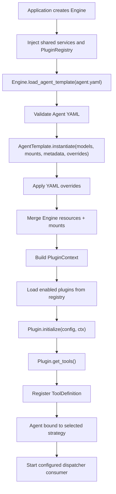
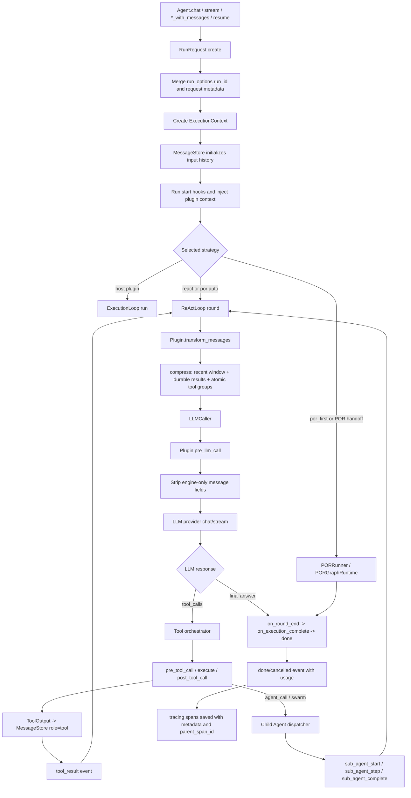

<h1 align="center">AxcAgentEngine</h1>

<p align="center">
  <b>Headless agent execution engine with pluggable ReAct and POR loops</b>
</p>

<p align="center">
  
  
  
  
</p>

<p align="center">
  <a href="#-quick-start">Quick Start</a> &middot;
  <a href="#-features">Features</a> &middot;
  <a href="docs/ARCHITECTURE.md">Architecture</a> &middot;
  <a href="docs/PLUGIN_DEVELOPMENT.md">Plugins</a> &middot;
  <a href="examples/README.md">Examples</a>
</p>

<p align="center">
  <a href="README.zh-CN.md">&#x1F1E8;&#x1F1F3; Chinese</a>
</p>

---

AxcAgentEngine is a headless agent execution engine. Strategy plugins supply the loop. The bundled **ReAct** strategy runs model and tool rounds. **POR** plans, schedules steps by dependency, observes results, and replans. Hosts can supply their own loop. The engine manages live input, cancellation, and checkpoints.

## 🚀 Quick Start

```bash
# Run from this checkout to use the examples below
pip install .

# Optional dependencies for the HTTP API, MCP, and Burr workflows
pip install ".[api,mcp,workflow]"
```

Requires Python 3.11 or newer.

```python
from axc_agent_engine import AgentModels, Engine, LLMConfig, PluginRegistry
from axc_agent_engine.llm.client import OpenAIClient
from axc_agent_engine.plugins.builtin import BuiltinToolsPlugin, PORPlugin

registry = PluginRegistry()
registry.register_many([PORPlugin, BuiltinToolsPlugin])

engine = Engine(plugin_registry=registry)
models = AgentModels(default=OpenAIClient(LLMConfig(
    base_url="https://api.openai.com/v1",
    api_key="sk-xxx",
    model="gpt-4o",
)))
agent = engine.load_agent_template("./examples/01_basic_chat/agent.yaml").instantiate(models=models)

# Non-streaming
result = await agent.chat("Analyze last month's sales data")

# Streaming
async for event in agent.stream("Build a REST API for user management"):
    if event.type == "stream_delta":
        print(event.content, end="")
    elif event.type == "tool_call":
        print(f"\n[Tool: {event.tool_name}]")
    elif event.type == "plan_created":
        print(f"\n[Plan: {event.content}, {len(event.steps)} steps]")

await engine.close()
```

Examples 01–07 register `PORPlugin`, enable `plugins.por`, and set `runtime.strategy: por` and `plugins.por.mode: auto`. For pure ReAct, register `ReActPlugin`, enable `plugins.react.enabled: true`, and select `runtime.strategy: react`. A sole enabled strategy is selected automatically. With several enabled, name one explicitly. Custom loops follow the same contract. [Custom loop example](examples/08_custom_loop) · [Strategy contract](docs/PLUGIN_DEVELOPMENT.md#execution-strategies)

## ✨ Features

- **POR strategy plugin** — choose `por_first` (default) to plan immediately or `auto` to start in ReAct and switch when the model produces a plan
- **ReAct strategy plugin** - standard think / call / observe loop
- **Plugin system** - explicit class registration and YAML-driven loading
- **Tool protocol** - every tool returns `ToolOutput`; read-only runs concurrent, write serial; safe function-name mapping
- **Durable workflow** - `WorkflowRuntime` + `CheckpointStore` + Agent resume API; Burr is optional via `axc-agent-engine[workflow]`
- **OpenAI compatible** - provider protocol + OpenAI-compatible HTTP client and API subset
- **Memory & knowledge** - four-layer memory (KV, dedup, decay, graph hooks) + plugin-owned hybrid retrieval
- **Runtime binding** - models, mounted resources, request metadata, and YAML overrides stay in separate channels
- **MCP** - stdio, JSON-RPC HTTP, official SDK transports
- **Human-in-the-loop** - approval queue and `ask_human` tool
- **Sidecar suite** - multi-agent, simulation, eval, cost, failure mining, trace distillation

<details>
<summary>Full capability matrix</summary>

| Capability | Implementation |
| --- | --- |
| ReAct loop | `ReActPlugin` |
| POR planning | `PORPlugin` with `auto` / `por_first` |
| Durable workflow | `MemoryWorkflowRuntime` by default; optional `BurrWorkflowRuntime` via `axc-agent-engine[workflow]` |
| Plugin system | Host registry + YAML-driven loading |
| LLM provider | provider protocol + OpenAI-compatible HTTP |
| Parallel tools | read concurrent, write serial |
| Tool output | enforced `ToolOutput` |
| Tool name mapping | provider-side model-safe mapping |
| Context compression | built-in `compress` plugin |
| Memory | four layers + KV persistence + dedup + decay |
| Knowledge | plugin-owned retrieval over local sources or mounted indexes/resources |
| MCP | stdio / JSON-RPC HTTP / official SDK |
| Human approval | approval queue + `ask_human` |
| Sidecar | multi-agent / simulation / eval / cost / failure mining / distillation |
| API server | OpenAI Chat Completions compatible subset |

</details>

## 📦 Docs

| | |
| --- | --- |
| [Architecture](docs/ARCHITECTURE.md) | Engine and plugin boundaries |
| [API](docs/API.md) | HTTP API subset notes |
| [Plugin development](docs/PLUGIN_DEVELOPMENT.md) | Build your own plugin |
| [Security model](docs/SECURITY_MODEL.md) | Capabilities, risk, workspace |
| [Examples](examples/README.md) | 7 end-to-end demos |
| [Contributing](CONTRIBUTING.md) / [Security](SECURITY.md) / [LICENSE](LICENSE) | Apache-2.0 |

## Agent YAML

```yaml
name: "data-analyst"
description: "Data analysis assistant"

runtime:
  strategy: por
  max_rounds: 50
  thinking: "auto"
  workspace: "/tmp/agent-workspace"
  allowed_capabilities:
    - "file_read"
    - "file_write"
    - "http_request"

system_prompt: |
  You are a data analysis assistant...

plugins:
  por: {enabled: true, mode: auto}
  builtin_tools:
    enabled: true
    load: ["get_time", "file_read", "file_write", "http_request", "artifact_read"]
    defer: ["file_write", "http_request"]

  knowledge:
    enabled: true
    sources: ["./docs"]
    namespace: "default"

  memory:
    enabled: true
    namespace: "default"
    scope_keys: ["tenant_id", "user_id", "agent_name"]
    sensitive_policy: "redact"

  compress:
    enabled: true
    summary:
      after_rounds: 8
    durable_tools:
      names: ["agent_call", "knowledge_search"]
      keep: 12

  risk_guard:
    enabled: true
```

Notes:

- Plugin registration is explicit host code via `PluginRegistry`. Agent YAML only enables and configures already-registered plugins.
- `builtin_tools` loads only `get_time` when `load` is omitted; other built-ins must be explicitly enabled.
- Tools with a non-empty capability are denied by default; list them in `runtime.allowed_capabilities`.
- File and command tools require `runtime.workspace` by default.
- LLM configuration is provided in code, not in Agent YAML.
- Official builtin plugin YAML is for behavior parameters only. External endpoints, API keys, client objects, indexes, stores, and catalogs are mounted in code.

## Provider Configuration

`AgentModels` accepts model provider objects. `OpenAIClient(LLMConfig(...))` is the built-in OpenAI-compatible provider; custom providers implement `LLMProvider` (`model`, `tool_name_mapping`, `chat`, `stream`, `ask`, `close`).

```python
from axc_agent_engine import AgentModels, ConcurrencyConfig, Engine, LLMConfig, PluginRegistry
from axc_agent_engine.llm.client import OpenAIClient
from axc_agent_engine.plugins.builtin import BuiltinToolsPlugin, PORPlugin
from axc_agent_engine.tools.name_mapping import ToolNameMappingConfig

main_model_config = LLMConfig(
    base_url="https://api.openai.com/v1",
    api_key="sk-xxx",
    model="gpt-4o",
    timeout=120,
    max_concurrent_requests=32,
    requests_per_minute=0,
    rate_limit_queue_timeout=10,
    tool_name_mapping=ToolNameMappingConfig(),
)

registry = PluginRegistry()
registry.register_many([PORPlugin, BuiltinToolsPlugin])
engine = Engine(
    plugin_registry=registry,
    concurrency=ConcurrencyConfig(
        max_engine_concurrent_runs=128,
        queue_timeout=30,
    ),
)
agent = engine.load_agent_template("./examples/01_basic_chat/agent.yaml").instantiate(
    models=AgentModels(default=OpenAIClient(main_model_config)),
)
```

Tool-name mapping is the provider's job. Internal tool names are encoded to model-safe function names before the LLM call and decoded before hooks and tool execution.

## Runtime Binding

Agent YAML describes stable behavior. Runtime objects are bound in code when the template is instantiated:

```python
agent = template.instantiate(
    models=AgentModels(
        default=gpt5_provider,
        utility=fast_provider,
        fallback=backup_provider,
    ),
    mounts={
        "knowledge.index": tenant_knowledge_index,
        "graph.store": tenant_graph_store,
        "skill.catalog": tenant_skill_catalog,
    },
    metadata={
        "tenant_id": "t_001",
    },
    overrides={
        "plugins.knowledge.namespace": "tenant:t_001",
        "plugins.skill.timeout": 30,
    },
)
```

- `models` binds provider objects for this Agent instance; the Engine does not own model configuration.
- `mounts` injects host-owned runtime resources for this instantiation and overrides Engine-level resources with the same name.
- `metadata` attaches instance metadata; request metadata can still override it inside a single chat/stream call.
- `overrides` patches validated Agent YAML fields before plugins are initialized. It only accepts YAML-serializable values and cannot bind runtime resources.

Preferred official resource slots are `knowledge.index`, `graph.store`, `skill.catalog`, and `tracing.exporter`. Advanced knowledge slots such as `knowledge.documents`, `knowledge.embedding`, `knowledge.vector_store`, and `knowledge.reranker` are also supported by the current plugin, but they are still runtime mounts, not YAML or `overrides` values.

## Request Metadata and Tracing

Run-level metadata is passed through the public Agent entry points and reaches `ExecutionContext.state.metadata`. The tracing plugin copies this metadata into every span, while keeping top-level `run_id`, `session_id`, `span_id`, and `parent_span_id`.

```python
async for event in agent.stream_with_messages(
    messages,
    session_id="123",
    llm_options={"temperature": 0.2},
    run_options={"run_id": "run_abc"},
    metadata={
        "external_trace_id": "trace_1001",
        "conversation_id": 123,
        "agent_profile_id": 9,
    },
):
    ...
```

Use this for host-side trace or audit correlation. Do not encode external correlation IDs in prompts, tool arguments, or fake tool messages.

## Cancellation and Usage

Every run receives a `run_id` through `run_options.run_id`, `metadata.run_id`, or engine generation. Hosts should cancel a run through the Engine so nested `agent_call`, swarm, sidecar-owned Agent runs, and active tools share the same cancellation signal:

```python
engine.cancel_run("run_abc", reason="user_cancelled")
```

Streaming callers receive a terminal `cancelled` event. Non-streaming callers receive `CancelledError`. Terminal `done` and `cancelled` events include aggregated usage in `event.metadata["usage"]`:

```python
{
    "input_tokens": 1200,
    "output_tokens": 380,
    "total_tokens": 1580,
}
```

Hosts should read this aggregate instead of summing scattered LLM or sub-Agent events.

## Multimodal Messages

The host owns uploads, authorization, OCR, image recognition, media URLs, and base64 generation. The engine only accepts normalized message content parts and passes them through the input/provider boundary:

```python
messages = [{
    "role": "user",
    "content": [
        {"type": "text", "text": "Explain this screenshot."},
        {"type": "image_url", "image_url": {"url": "https://example.com/screen.png"}},
        {"type": "image_base64", "media_type": "image/png", "data": "..."},
        {"type": "file_ref", "ref": "artifact:123", "metadata": {"name": "report.pdf"}},
    ],
}]
```

Unsupported part types fail immediately. Official plugins do not fetch host media services or perform deployment-specific multimodal preprocessing.

## Tool Output Views

`ToolOutput` separates the LLM context view from the UI display view:

- `content` remains the structured tool payload for hosts, UI, artifacts, and programmatic handling.
- `llm_view` is an optional text view written for LLM reasoning. Use it when structured JSON would be harder for the model to read.
- `context_view()` is written into `MessageStore` for the next LLM round. It prefers `durable_summary`, then `llm_view`, then full `content`, and preserves artifact refs. `summary` is metadata, not a replacement for the LLM view.
- `display_view()` is used by `tool_result` events for host/UI display. It exposes full content; UI preview limits belong in the host UI layer.
- New code should call `context_view()` or `display_view()` explicitly.

Hosts should not monkey patch `ToolOutput` to change LLM context behavior.

Tool implementations must not use default truncation, omission, or count-only `llm_view` text. List-style tools must include item identifiers such as names, paths, or ids. Content-style tools must return full content unless the caller explicitly requested ranges or pages. Oversized results should be externalized to an `ArtifactStore` artifact and the `llm_view` must include the `artifact_id` and tell the model to use `artifact_read` or `artifact_page`; it must not emit vague omitted text.

Official high-signal tools such as `agent_list`, `agent_call`, `knowledge_search`, `graph_search`, `memory_search`, `swarm_dispatch`, `file_read`, `file_list`, `file_glob`, `file_tree`, `list_traces`, `get_trace`, and `artifact_search` provide LLM-friendly `llm_view` text while keeping structured `content` for hosts.

## ArtifactStore

`ArtifactStore` is the host-owned storage boundary for large tool results and generated artifacts. The engine defines the protocol and ships `InMemoryArtifactStore` for local development. Production hosts should inject a durable backend through `Engine(artifact_store=...)`.

The protocol supports text, bytes, and file-reference artifacts:

- `put_text(...)` and `put_bytes(...)` store inline content in the backend.
- `put_file_ref(path, ...)` registers a file path without copying the file into memory or duplicating a large file.
- `read(...)`, `read_page(...)`, and `search(...)` are exposed to the model through `artifact_read`, `artifact_page`, and `artifact_search`.
- `stat(...)`, `delete(...)`, `delete_run(...)`, and `gc(...)` let the host manage lifecycle.

Artifacts can carry `run_id`, `expires_at`, and `durable` metadata. Non-durable artifacts should be garbage-collected by run/session policy; durable artifacts are retained by host policy.

## Durable Tool Results and Sub-Agent Events

The `compress` plugin preserves assistant tool calls and their matching tool results as atomic groups. Durable tool results are also saved into the compression boundary and reinjected after context packing. By default, `agent_call` and `knowledge_search` are durable; domain tools can opt in with `compress.durable_tools.names`, `compress.durable_tools.capabilities`, or `ToolOutput.with_metadata({"durable": True, "durable_summary": "..."})`.

`collaboration.agent_call` streams child Agent activity back to the parent run as standard events:

- `sub_agent_start`
- `sub_agent_step`
- `sub_agent_complete`

Stable fields include `parent_tool_call_id`, `sub_run_id`, `agent_name`, `agent_id`, `step.type`, `tool_call_id`, `tool_name`, `content`, `artifacts`, `error`, and `duration_ms`. Frontends should render these events directly. They should not parse `agent_call` tool results to invent a child execution timeline.

## API

The HTTP API is an OpenAI Chat Completions compatible subset.

- `POST /v1/chat/completions`
- `GET /v1/agents`
- `GET /v1/capabilities`

Request-level `tools` and `tool_choice` are intentionally unsupported. Tools come from Agent YAML and plugins so the engine can enforce capabilities, risk metadata, plugin hooks, workspace policy, and audit events.

Clients should not assume full OpenAI parity; call `/v1/capabilities` first. See [docs/API.md](docs/API.md).

## Built-in Plugins

Capabilities not required by a basic agent live in plugins. The default `Engine.plugin_registry` is empty; both built-in and custom plugins must be registered explicitly.

```python
from axc_agent_engine import AgentModels, Engine, PluginRegistry
from axc_agent_engine.plugins.builtin import BuiltinToolsPlugin, MemoryPlugin, PORPlugin
from my_project.plugins import MyCustomPlugin

registry = PluginRegistry()
registry.register_many([PORPlugin, BuiltinToolsPlugin, MemoryPlugin, MyCustomPlugin])
engine = Engine(plugin_registry=registry)
agent = engine.load_agent_template("./agents/my_agent.yaml").instantiate(models=AgentModels(default=llm))
```

| Plugin | Purpose |
| --- | --- |
| `react` | Run a model and tool loop |
| `por` | Plan, execute, observe and replan, with optional automatic handoff |
| `builtin_tools` | Basic tools and artifact paging |
| `knowledge` | Ingestion, semantic chunking, hybrid retrieval, citations, rerank |
| `memory` | Memory, governance tools, sensitive-data policy, decay, TTL |
| `output_format` | Final output contracts, validation, repair, audit |
| `post_process` | Optionally append round and token counts before final output validation |
| `graph` | Entity/relation graph search and CRUD |
| `skill` | Load skills, run scripts through sandbox |
| `mcp` | MCP server tool loading and guarding |
| `hooks` | Declarative LLM/tool hook rules |
| `compress` | Context window management, summaries, recall, file restore |
| `human_in_the_loop` | Human approval and `ask_human` |
| `risk_guard` | Dynamic tool risk classification |
| `safety` | Input sanitization, prompt-injection checks, PII masking |
| `tracing` | Trace/span collection, audit mode, query tools |
| `reflexion` | End-of-round and end-of-run self-reflection |
| `repetition_guard` | Repeated tool / response / result detection |
| `cost_statistics` | Input and output token accounting |
| `collaboration` | Agent-to-agent calls and host orchestration entry |
| `swarm` | Lightweight parallel fan-out |

### Engineering tools

Enable `file_grep` in `plugins.builtin_tools.load`, grant `file_read`, and configure the workspace. Install ripgrep (`rg`) in the command execution environment. Matches include paths, line numbers, and text.

`file_edit` matches exact text, including quotes and line endings. Inline `file_read` results include the whole file’s `sha256`. Pass it as `expected_sha256` to `file_edit`, `file_write`, or `file_append` to reject stale content. Hosts own cross-process workspace isolation.

The local executor returns up to 1 MiB inline per output stream. Larger streams are saved in full under `.axc/logs/` in the command working directory. Supply an `ArtifactStore` to retrieve them through `artifact_read` or `artifact_page`. The host can remove log files once their artifact references expire.

## Sidecar Capabilities

Sidecars live under `axc_agent_engine.sidecar` and are invoked explicitly by the host, not part of the agent's core execution path. See [axc_agent_engine/sidecar/README.md](axc_agent_engine/sidecar/README.md).

| Package | Purpose |
| --- | --- |
| `sidecar.multi_agent` | Multi-agent sessions, schedulers, stop conditions, shared context |
| `sidecar.simulation` | Structured simulation kernel |
| `sidecar.eval` | Evaluation cases, annotation stores, matcher, runner, reports |
| `sidecar.agent_selector` | Host-side agent routing and candidate scoring |
| `sidecar.distiller` | Distill rules, tool preferences, and skill candidates from traces |
| `sidecar.failure_miner` | Cluster failures and suggest remediation / eval coverage |
| `sidecar.cost_optimizer` | Cost estimation and optimization findings |

```python
from axc_agent_engine import AgentModels, Engine
from axc_agent_engine.sidecar import OrchestrationTaskService
from axc_agent_engine.storage.in_memory import InMemoryMessageBus

engine = Engine(message_bus=InMemoryMessageBus())
models = AgentModels(default=main_model, utility=utility_model)
red = engine.load_agent_template("./agents/red.yaml").instantiate(models=models)
blue = engine.load_agent_template("./agents/blue.yaml").instantiate(models=models)

service = OrchestrationTaskService(
    agent_getter=engine.get_agent,
    agent_lister=engine.list_agents,
    dispatcher=engine._dispatcher,
    utility_model=utility_model,
)

task = await service.run_task(
    agent_names=[red.name, blue.name],
    mode="redblue",
    topic="Plugin marketplace security tabletop",
    max_rounds=3,
)
```

Sidecar components that create internal Agent runs accept standard run context:

- `EvalRunner.run_cases(..., run_options, metadata, case_run_options, case_metadata)`
- `MultiAgentSession.run/stream(..., run_options, metadata, agent_run_options, agent_metadata)`
- `SimulationRunner.run/stream(..., run_options, metadata, actor_run_options, actor_metadata)`

Factory metadata supplements the base metadata for each case, agent, or actor. `EvalCase.metadata` remains evaluation/scoring metadata and is not request metadata.

## Runtime Flow

### Load time



### One agent run



## Plugin Development

```python
from axc_agent_engine import BasePlugin, ToolDefinition, ToolOutput
from axc_agent_engine.plugins.config_schema import config_field, config_schema

class MyPlugin(BasePlugin):
    name = "my_plugin"
    display_name = "My Plugin"
    priority = 30
    phase = "core"
    config_schema = config_schema(
        "my_plugin",
        "My Plugin",
        "Configuration for MyPlugin.",
        [
            config_field(
                "api_url",
                "接口地址",
                "string",
				"插件调用的后端接口地址。",
				label_en="API URL",
				default="http://localhost:5000",
			),
		],
        display_name_en="My Plugin",
    )

    def initialize(self, config: dict, ctx) -> None:
        super().initialize(config, ctx)
        self.api_url = config["api_url"]

    def get_tools(self) -> list[ToolDefinition]:
        return [ToolDefinition(
            name="my_tool",
            description="Does something useful",
            parameters={"type": "object", "properties": {"query": {"type": "string"}}},
            execute=self._execute,
        )]

    async def pre_tool_call(self, exec_ctx, tool_name, arguments):
        return True, arguments

    async def _execute(self, args: dict, context: dict) -> ToolOutput:
        data = {"query": args["query"], "matches": [{"title": "Example", "score": 0.92}]}
        return ToolOutput(
            content=data,
            content_type="json",
            summary="Found 1 match",
            llm_view="Search results:\n1. Example | score=0.92",
        )
```

Plugins must inherit `BasePlugin`, declare `config_schema`, and return tools as `ToolDefinition` instances. `ToolRegistry` does not accept dicts.

Hosts can inspect registered plugin schemas through `registry.list_plugin_config_schemas()` or `registry.get_plugin_config_schema("my_plugin")`. The loader validates YAML against that schema before calling `initialize(config, ctx)` and rejects unknown fields.

```yaml
plugins:
  my_plugin:
    enabled: true
    api_url: "http://localhost:5000"
```

## CLI

```bash
export AXC_LLM_BASE_URL="https://api.openai.com/v1"
export AXC_LLM_API_KEY="sk-xxx"
export AXC_LLM_MODEL="gpt-4o"

axc chat --agent ./agents/my_agent.yaml
axc serve --agent ./agents/my_agent.yaml --port 8000
axc --log-level DEBUG --json-logs chat --agent ./agents/my_agent.yaml
```

CLI logging flags are global and must be placed before the subcommand.

Inspect the assembled agent with the CLI's bundled plugin registry. This command initializes configured plugins and prints JSON without making a model call.

```bash
axc inspect --agent examples/01_basic_chat/agent.yaml
```

`strategy.reason` reports `explicit` for a named selection, `single_enabled` for one enabled strategy, or `runtime_routing` for an older routing template. The output includes plugin initialization order, registered tools, and capability permissions. Tools discovered during a run appear after discovery. A custom policy reports `null` for a tool's static permission. Hosts supplying their own plugins, mounts or policies can inspect the bound agent with `agent.inspect()`.

## Design Decisions

- **Execution strategies supply the loop.** Executor manages each run. Hosts can select an official ReAct or POR driver or register their own [execution strategy](docs/PLUGIN_DEVELOPMENT.md#execution-strategies).
- **POR state transitions live in pydantic-graph.** `PORGraphRuntime` owns the plan/step/observe/replan loop; services execute work and persist checkpoints.
- **Workflow resume is a runtime boundary.** `MemoryWorkflowRuntime` is the default; `BurrWorkflowRuntime` is selected explicitly by the host after installing the workflow extra.
- **Plugins are the runtime extension boundary.** Knowledge, memory, graph, MCP, output repair, skills belong in plugins.
- **Orchestration is sidecar.** Multi-agent sessions, simulation, mode adapters are host-driven.
- **Evaluation is sidecar.** EvalRunner, stores, matchers, reports are host-driven test framework pieces.
- **Explicit plugin loading.** Hosts register the classes they need from the official catalog. Templates enable them with `enabled: true`.
- **Plugin schema is mandatory.** A plugin without `config_schema` cannot be registered.
- **Tools come from plugins.** The engine core embeds no business tools.
- **Tools must return `ToolOutput`.** Non-`ToolOutput` returns are rejected.
- **Tool definitions must be `ToolDefinition`.** No dicts.
- **Deployment-specific protocols stay out.** External APIs, deployment databases, auth flows, and service discovery belong in host plugins.
- **LLM config lives in code.** Agent YAML describes runtime limits, capabilities, and plugins.
- **Fatal errors are not hidden by fallback logic.** Invalid configuration, invalid runtime resources, broken tool contracts, and flow errors must fail clearly.
- **Official plugins stay lean.** They may strengthen Agent behavior, but they do not own host network clients, deployment API keys, external services, or deployment-specific protocols.
- **Package `__init__.py` files only re-export symbols.** Implementations, registries, factories, version constants, and protocols live in normal modules.
- **Runtime resources use mounts.** Do not pass resources through YAML or `overrides`.
- **Request correlation uses metadata.** Hosts pass external trace identifiers through `metadata`; tracing spans persist them directly.
- **The API is a subset.** Request-level `tools`, `tool_choice`, `n > 1` are rejected.

## Tests

```bash
.venv/bin/python -m pytest --cov=axc_agent_engine -q
make test-core-cov
```

The release gate requires at least 95% total coverage. The engine-body coverage target is 98%.

### Send input to a running agent

Give the run a unique ID before starting the stream. The host can submit more text while a model or tool is working. Use the same agent, session, run ID and message ID when retrying delivery.

```python
async for event in agent.stream("Review both reports", session_id="review", metadata={"run_id": "review-42"}):
    if event.type == EventType.STEP_START and event.step_id == 1:
        receipt = await agent.send_message("review-42", "Focus on the second report",
                                           session_id="review", message_id="change-1")
    if event.type in {EventType.DONE, EventType.CANCELLED, EventType.ERROR}:
        print(event.metadata.get("processed_message_ids", []), event.metadata.get("unprocessed_message_ids", []))
```

An `accepted` receipt puts the message in FIFO order. `processed` means the text entered run history. A tool already in flight may finish first. POR publishes plan and step events during execution and revises remaining work at the next planning boundary. Cancellation uses `engine.cancel_run(run_id)`. The offline demo exercises both completion and cancellation. [Runnable example](examples/09_live_input/run.py)

Keep requests for an active run on the engine process that owns it. A durable host `CheckpointStore` can recover accepted input after process loss. Unknown write-tool outcomes block resume until the host reconciles the recorded call IDs. See the plugin guide for the full receipt and recovery contracts. [Plugin guide](docs/PLUGIN_DEVELOPMENT.md)

Fork an execution with `await agent.fork_run(run_id, checkpoint_id)`. Select a retained `cp.forkable` checkpoint and continue the new run through `resume_stream`. [Execution forks](docs/ARCHITECTURE.md#execution-forks)
